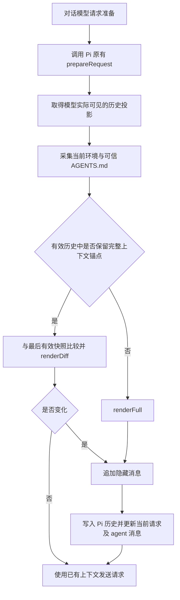

# ArkCode 静态与动态上下文机制

本文记录当前实现，更新于 2026-10-13。ArkCode 使用稳定的 system 行为准则、常驻工具声明和追加式动态上下文构造对话请求。动态信息更新时保留已有消息，便于模型供应商复用相同的请求前缀。

## 请求由哪些部分组成

| 部分 | 内容 | 提供方式 | 更新时机 |
| --- | --- | --- | --- |
| 静态行为准则 | ArkCode 身份、任务范围、工具使用、用户改动保护、拒绝处理、验证与沟通要求 | `SYSTEM_PROMPT`，由 Pi 构建 system prompt | 创建或替换 AgentSession 时使用当前代码中的版本 |
| Pi 工作目录段 | 当前会话的 cwd | SDK 添加的 system prompt `cwd` 段 | 创建或替换会话时确定 |
| 工具声明 | Read、Write、Edit、Grep、Glob、Bash 的名称、描述及参数 schema | 请求的工具声明，由 Pi 管理 | 同一工作区、相同 shell 下保持常驻；权限切换不改变声明 |
| 对话历史 | 用户输入、模型回答、工具调用及结果、compact 摘要 | Pi 会话历史的有效投影 | 随对话追加，compact 可改变模型可见的历史 |
| 动态上下文 | 环境信息及可信 AGENTS.md | 内部隐藏 custom 消息，发送前转换为 user role | 每次对话模型请求准备时检查，仅有变化时追加 |

“静态”指行为文本不随日期、权限模式和 AGENTS.md 改写。当前 SDK 仍会添加 cwd 段，因此不同工作区的完整 system prompt 可以不同。

目前 ArkCode 不自动加载项目 skills、prompt templates、主题或扩展。用于 compact 文件操作跟踪的内置扩展由宿主显式注册。

## 静态 system prompt

`src/prompt.ts` 中的 `SYSTEM_PROMPT` 分为身份说明和三个行为部分。

- 任务范围：落实用户要求，分析任务只调查和报告；先检查实现及项目指令，保留用户修改和无关工作，接收运行中的用户调整。
- 工具使用：Read 读取文件，Grep 搜索内容，Glob 搜索文件名，Edit 精确替换，Write 新建或完整覆盖，Bash 执行实际宿主 shell；宿主处理工具审批，模型尊重拒绝和任务边界。
- 证据与沟通：依据工具结果判断成功、失败和中断，执行相关验证，使用用户语言汇报；识别动态上下文更新的替换语义，不把 compact 摘要作为当前环境事实的权威来源。

`createResources()` 提供这段文本。运行时通过 `withoutProjectSystem()` 将 SDK 的 `getAgentsFiles()` 结果置空，避免 AGENTS.md 同时进入 system prompt。动态机制另行读取可信项目指令。

## 动态环境字段

`src/context.ts` 使用 `ContextSnapshot` 保存环境和项目指令快照。

| 字段 | 含义 | 采集方式 |
| --- | --- | --- |
| `cwd` | 会话工作目录 | 创建会话时传入，切换工作区时重新安装机制 |
| `platform` | Node 平台标识，例如 `win32` | `process.platform` |
| `os` | OS 类型与版本 | 安装机制时读取 `os.type()` 和 `os.release()` |
| `shell` | Bash 工具实际使用的 shell | 当前 `ManagedShell.executable`；Windows 默认 `powershell.exe` |
| `current_date` | 当前时区中的日期 | 每次请求准备时读取时钟，格式为 `YYYY-MM-DD` |
| `timezone` | 宿主时区 | 每次请求准备时读取 Intl 的时区，缺省回退为 UTC |
| `git_branch` | 当前 Git 分支或无仓库状态 | 每次请求准备时调用 `getBranch()` |
| `execution` | 宿主执行可用性 | `available` 或 `inspection-only` |

`execution` 来自执行未确认、历史存储失败和 viewer 状态，表示宿主恢复或执行限制。它不表示 Always Ask、Ask When Needed 或 Never Ask，也不提供完整工具权限矩阵。真正的限制由执行入口强制检查；viewer 和存储失败通常会在发送模型请求前被阻止。

宿主不会注入每轮时间戳、已用 token、UI 的 Working 状态或权限模式。这样可避免没有必要的差量消息。

## AGENTS.md 的读取与替换

可信工作区在每次对话请求准备时调用 `readInstructions(cwd)`，从文件系统根目录到 cwd，依次读取这些目录下的 AGENTS.md。每个文件最多读取 64 KiB，合计最多 128 KiB；超出单文件限额时附加截断说明。未信任工作区的指令集合为空。

自动扫描只覆盖 cwd 及其祖先，不扫描所有子目录。模型进入更具体的目录处理文件时，仍需检查该目录适用的项目指令，静态 prompt 已包含这一要求。

AGENTS.md 的路径、内容或集合变化时，宿主追加整个当前指令集合，并声明它替换此前宿主提供的项目指令。删除某个文件后，该来源不会继续出现在新集合中；集合为空时明确说明没有可信项目指令。旧消息仍在历史中，模型依据替换声明使用当前版本。

指令内容与环境值均进行 XML 文本转义，避免原文中的标签破坏宿主生成的外层结构。

## renderFull 与 renderDiff

`renderFull(snapshot)` 生成完整的 `<environment_context>` 和 `<project_instructions>`。`renderDiff(previous, current)` 只输出变化的环境字段；项目指令发生变化时输出完整指令替换集合。所有值相同则返回 `undefined`，不追加消息。

第一次请求的动态内容形如：

```xml
<environment_context>
<cwd>D:\ArkCode</cwd>
<platform>win32</platform>
<os>Windows_NT 10.0.26200</os>
<shell>powershell.exe</shell>
<current_date>2026-10-13</current_date>
<timezone>Asia/Shanghai</timezone>
<git_branch>main</git_branch>
<execution>available</execution>
</environment_context>
<project_instructions>
These replace all previously supplied project instructions. Earlier sources omitted below no longer apply. More specific directory instructions apply within their scope.
<instructions path="D:\ArkCode\AGENTS.md">
项目指令内容
</instructions>
</project_instructions>
```

日期跨日且其他值未变时，只追加：

```xml
<environment_context>
<current_date>2026-10-14</current_date>
</environment_context>
```

新日期本身就是提醒，不另外增加普通用户可见消息。

## 请求准备与隐藏消息

`installDynamicContext()` 包装 Pi 的公开 `session.agent.prepareRequest`。这个入口覆盖首次对话请求、工具调用后的继续请求，以及 compact 后下一次对话请求。“按 turn 更新”在当前实现中具体指每次对话模型请求边界，粒度比用户按 Enter 提交一次任务更细。



宿主在待处理用户输入和工具结果已加入上下文后，追加动态消息。它不插入旧历史中间，也不改写已有消息。单纯的 HTTP 传输重试不是额外的环境刷新定时器，独立的 compact 摘要请求也不经过这段对话注入逻辑。

内部消息使用以下结构：

```text
role: custom
customType: arkcode-context
display: false
content: 本次完整或差量文本
details: { version: 1, kind: full | diff, snapshot: 完整当前快照 }
```

Pi 的消息转换器将该 custom 消息转换为供应商请求中的 `user` role，只发送 `content`。`details` 中的完整快照用于宿主恢复基线，不作为额外 prompt 发送给模型。XML 标签只是文本结构，不会将消息提升为 system 权限。

宿主直接追加持久消息并更新当前请求，不发出动态消息的 UI 生命周期事件。TUI 历史恢复也会跳过 `display: false` 的条目，因此动态上下文不会成为可见转录。隐藏只指 UI 展示；内容仍发送给模型并保存在会话文件中。

追加前后有请求取消检查。新消息使用持久条目的时间戳，使当前请求中的消息与后续恢复出的消息保持一致。

## 会话生命周期与刷新规则

| 情况 | 行为 |
| --- | --- |
| 新会话首次请求 | 没有有效基线，注入完整上下文 |
| 后续用户轮次 | 重新采集；不变则不追加，变化则追加差量 |
| 工具续跑 | 在下一次对话请求前重新采集，工具造成的分支或 AGENTS.md 变化可在此时进入上下文 |
| 跨日 | 按宿主时区计算新日期，下一次对话请求追加日期差量；空闲时不主动唤醒会话 |
| 恢复会话 | 重新采集当前信息，对比有效历史中的基线；相同则不重复注入 |
| fork | 使用分支保留的有效消息确定基线，首次请求重新采集当前信息；不重放工具 |
| 切换工作区 | 创建对应 AgentSession，使用新的 cwd、shell、信任状态和当前信息 |
| 手动或自动 compact | 下一次对话请求检查 compact 后实际保留的消息，决定完整或差量注入 |
| 权限模式切换 | 只更新执行时的审批策略，不添加权限 prompt，不改变六工具声明 |

`contextUpdate()` 只相信模型当前有效历史中的 `arkcode-context` 消息及通过 schema 验证的元数据。它从完整 `full` 消息建立基线，然后接受其后的 `diff` 快照；如果只剩差量而没有完整锚点，必须重新注入完整内容。

因此，compact 后即使宿主知道先前快照，也不会假定模型仍拥有完整环境和项目指令。完整锚点被压缩掉时补回 full；锚点仍保留且值未变时不重复追加。compact 摘要中的旧环境信息不会建立基线。失败的 compact 不会仅因尝试过压缩而清空基线。

另外，`compactionTracking` 在摘要生成前补充大写 Read/Write/Edit 的文件操作记录，使六工具改名后仍能保留读取和修改的文件列表。

## 权限与 prompt cache

六个工具始终注册。Always Ask、Ask When Needed、Never Ask 的差别由 `ApprovalBroker` 与宿主执行入口处理，模型使用相同工具声明。静态 prompt 要求模型直接提交所需调用，宿主决定自动批准、询问或拒绝，模型不得绕过拒绝。

缓存设计的目标是保留供应商可以复用的相同前缀：

1. 日期、分支和 AGENTS.md 不改变静态行为文本。
2. 动态变化追加到历史末尾，已有消息保持原样。
3. 环境未变时不重复添加消息。
4. 权限切换不改变工具 schema，也不产生权限模式提醒。

compact 会重组有效历史，因此完整对话前缀不再保持。新工作区、代码版本导致的 system prompt 更新、模型或供应商切换也可能影响缓存。当前测试验证请求内容和前缀一致性，没有测量真实模型供应商的缓存命中率。

## 代码入口与验证范围

| 文件 | 职责 |
| --- | --- |
| `src/prompt.ts` | 静态行为文本 |
| `src/config.ts` | 资源加载与有大小限制的 AGENTS.md 扫描 |
| `src/context.ts` | 快照 schema、完整/差量渲染、隐藏持久消息、请求注入和 compact 文件跟踪 |
| `src/runtime.ts` | 会话安装、隐藏历史过滤、执行恢复限制 |
| `src/tools.ts`、`src/approval.ts` | 六工具声明及执行时审批 |
| `test/context.test.ts` | 跨日、差量、完整锚点丢失与取消行为 |
| `test/runtime.test.ts` | 本地模型请求中的 user role、前缀一致性、隐藏历史、AGENTS.md 修改/删除、恢复/fork/新会话、手动/自动 compact |

相关实现已通过类型检查、构建和本地测试服务驱动的请求验证。测试未调用外部模型，也不证明模型一定遵守项目指令替换声明；宿主权限和工具限制仍由代码执行。
