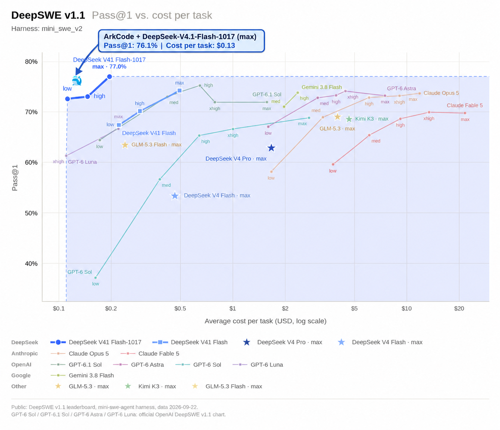

# ArkCode

[English](README.md) | 简体中文 | [文档首页](docs/zh-CN/README.md)

<p align="center">
  <strong>终端中的 AI 编码 Agent。</strong><br>
  读代码、改文件、运行命令，随时接着上次的工作继续。
</p>

<p align="center">
  <a href="docs/zh-CN/reference/platforms.md"></a>
  <a href="#基准测试"></a>
  <a href="#基准测试"></a>
</p>

<p align="center">
  <a href="#快速开始">快速开始</a> ·
  <a href="#功能">功能</a> ·
  <a href="docs/zh-CN/README.md">文档</a> ·
  <a href="CONTRIBUTING.md">参与贡献</a>
</p>

ArkCode 在本地项目中工作，提供交互式终端界面、可配置的工具审批和持久化会话。接入模型供应商或自定义端点后，用自然语言描述任务即可开始。

## 基准测试

**DeepSWE v1.1 上达到 76.1% pass@1，平均每项任务成本 $0.13。**

| Agent | 模型 | 推理强度 | pass@1 | 平均每项任务成本 |
| --- | --- | --- | --- | --- |
| ArkCode | DeepSeek-V4.1-Flash-1017 | `max` | **76.1%** | **$0.13** |

[](docs/shared/assets/deepswe-v1.1.png)

图中标注点为本项目报告的 ArkCode 成绩；背景曲线采用图中注明的 DeepSWE v1.1 公开结果及评测框架。点击图片可查看原图。

## 快速开始

需要 **Node.js 22.19+** 和 Git。在仓库根目录安装依赖并启动：

```sh
npm install
npm run build
npm start
```

首次启动时选择工作区信任级别，通过 `/connect` 选择供应商、模型和凭据，然后提交第一个任务：

```text
查看这个项目，说明入口文件和测试命令，先不要修改文件。
```

要在自己的项目中使用，先在 ArkCode 仓库执行一次 `npm link`，再到目标项目目录打开终端运行：

```sh
arkcode
```

在同一项目目录恢复最近的会话：

```sh
arkcode resume --last
```

Windows 优先使用 Git Bash，找不到时使用 PowerShell；macOS 和 Linux 使用 `/bin/sh`。更多步骤见[首次任务指南](docs/zh-CN/quickstart.md)、[自定义端点配置](docs/zh-CN/guides/models.md#添加自定义端点)和[平台依赖与验证范围](docs/zh-CN/reference/platforms.md)。

## 功能

| 能力 | 可以做什么 |
| --- | --- |
| 终端工作流 | 读取和搜索项目、修改文件、运行命令，并将后续任务加入队列。 |
| 模型接入 | 连接内置供应商或自定义端点，选择模型支持的推理强度。 |
| 工具权限 | 配置审批模式，在加载项目资源前选择工作区信任级别。 |
| 会话延续 | 在并行会话间切换、恢复历史，或创建对话分支。 |
| 项目工作流 | 加载 `AGENTS.md`、可复用的 Skills 和 MCP 服务器工具。 |
| 脚本调用 | 通过 `--print` 提交任务，或用 `--json` 处理结构化事件。 |

模型接入和工具循环基于 [Pi SDK](https://pi.dev/docs/latest)。ArkCode 管理权限、项目上下文、持续命令控制和上下文压缩。

## 文档

使用指南与接口参考见[完整文档](docs/zh-CN/README.md)，提供[简体中文和 English](docs/README.md) 两种语言。

| 我想要… | 查看 |
| --- | --- |
| 配置供应商、凭据和自定义端点 | [模型配置](docs/zh-CN/guides/models.md) |
| 排队任务、复制输出或中断运行 | [终端操作](docs/zh-CN/guides/terminal.md) |
| 新建、切换、恢复或分支会话 | [会话管理](docs/zh-CN/guides/sessions.md) |
| 设置审批模式和项目信任 | [权限与信任](docs/zh-CN/guides/permissions.md) |
| 编写项目规则和可复用工作流 | [AGENTS.md](docs/zh-CN/guides/instructions.md) · [Skills](docs/zh-CN/guides/skills.md) |
| 连接外部工具或搜索网页 | [MCP](docs/zh-CN/guides/mcp.md) · [Web Search](docs/zh-CN/guides/web-search.md) |
| 在脚本中调用 ArkCode | [脚本使用](docs/zh-CN/guides/scripting.md) · [JSON 事件](docs/zh-CN/reference/json-events.md) |
| 查询命令或解决问题 | [CLI 参考](docs/zh-CN/reference/cli.md) · [故障排查](docs/zh-CN/troubleshooting.md) |

## 参与贡献

本地开发、验证命令和文档维护规范见[贡献指南（英文）](CONTRIBUTING.md)。
