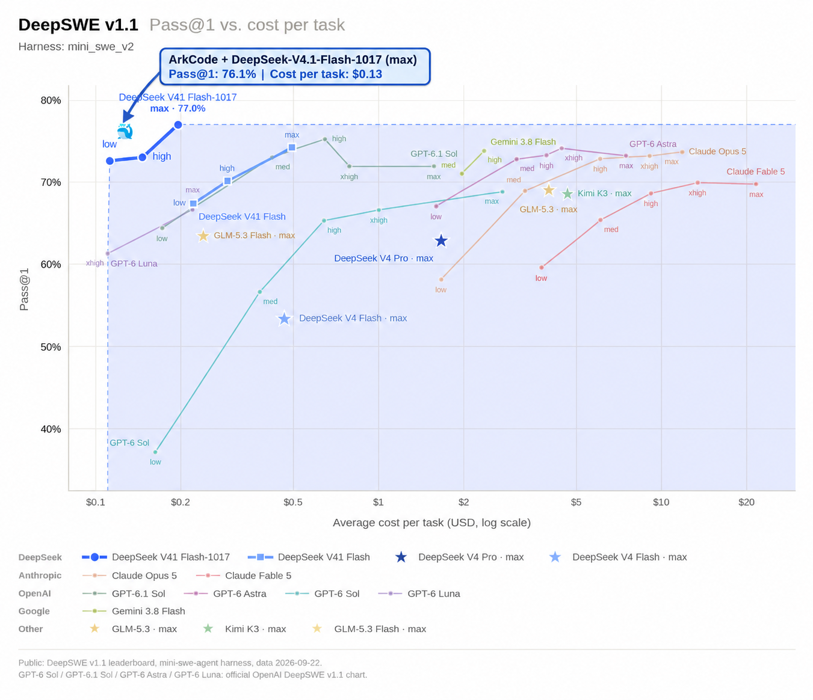

# ArkCode

English | [简体中文](README-CN.md) | [Docs home](docs/en/README.md)

<p align="center">
  <strong>An AI coding agent for your terminal.</strong><br>
  Read code, make changes, run commands, and pick up where you left off.
</p>

<p align="center">
  <a href="docs/en/reference/platforms.md"></a>
  <a href="#benchmark"></a>
  <a href="#benchmark"></a>
</p>

<p align="center">
  <a href="#quickstart">Quickstart</a> ·
  <a href="#features">Features</a> ·
  <a href="docs/en/README.md">Documentation</a> ·
  <a href="CONTRIBUTING.md">Contributing</a>
</p>

ArkCode works in your local project with an interactive terminal UI, configurable tool approvals, and persistent sessions. Bring your model credentials, connect a provider or custom endpoint, and start with a task in plain language.

## Benchmark

**76.1% pass@1 at an average of $0.13 per task on DeepSWE v1.1.**

| Agent | Model | Reasoning effort | pass@1 | Average cost / task |
| --- | --- | --- | --- | --- |
| ArkCode | DeepSeek-V4.1-Flash-1017 | `max` | **76.1%** | **$0.13** |

[](docs/shared/assets/deepswe-v1.1.png)

The annotated point is the project's reported ArkCode result. The background curves use the public DeepSWE v1.1 results and harness identified in the chart. Click the image to view it at full size.

## Quickstart

Requires **Node.js 22.19+** and Git. From the repository root, install dependencies and start ArkCode:

```sh
npm install
npm run build
npm start
```

On first launch, choose the workspace trust level. Run `/connect` to select a provider, model, and credentials, then submit your first task:

```text
Inspect this project, explain the entry file and test commands, and do not modify files.
```

To use ArkCode in your own projects, run `npm link` once in the ArkCode repository, then open a terminal in your project:

```sh
arkcode
```

Resume the latest session from the same project directory:

```sh
arkcode resume --last
```

Windows uses Git Bash when available and PowerShell otherwise. macOS and Linux use `/bin/sh`. See the [first-task walkthrough](docs/en/quickstart.md), [custom endpoint setup](docs/en/guides/models.md#add-a-custom-endpoint), and [platform requirements and verification scope](docs/en/reference/platforms.md).

## Features

| Capability | What you can do |
| --- | --- |
| Work in the terminal | Read and search a project, edit files, run commands, and queue follow-up tasks. |
| Choose your model | Connect built-in providers or custom endpoints and select the supported reasoning effort. |
| Control tool access | Choose approval modes and workspace trust before loading project resources. |
| Continue across sessions | Switch between concurrent sessions, resume saved history, or fork a conversation. |
| Add project workflows | Load `AGENTS.md`, reusable Skills, and tools from MCP servers. |
| Run from scripts | Submit a task with `--print` or consume structured events with `--json`. |

Model access and the tool loop use the [Pi SDK](https://pi.dev/docs/latest). ArkCode manages permissions, project context, persistent command control, and context compaction.

## Documentation

Find guides and references in the [documentation](docs/en/README.md), available in [English and 简体中文](docs/README.md).

| I want to… | Read |
| --- | --- |
| Configure providers, credentials, and custom endpoints | [Model configuration](docs/en/guides/models.md) |
| Queue tasks, copy output, or interrupt a run | [Terminal usage](docs/en/guides/terminal.md) |
| Create, switch, resume, or fork sessions | [Session management](docs/en/guides/sessions.md) |
| Set approval modes and trust a project | [Permissions and trust](docs/en/guides/permissions.md) |
| Define project rules and reusable workflows | [AGENTS.md](docs/en/guides/instructions.md) · [Skills](docs/en/guides/skills.md) |
| Connect external tools or search the web | [MCP](docs/en/guides/mcp.md) · [Web search](docs/en/guides/web-search.md) |
| Use ArkCode in scripts | [Scripting](docs/en/guides/scripting.md) · [JSON events](docs/en/reference/json-events.md) |
| Look up commands or resolve a problem | [CLI reference](docs/en/reference/cli.md) · [Troubleshooting](docs/en/troubleshooting.md) |

## Contributing

For local development, verification commands, and documentation guidelines, see [CONTRIBUTING.md](CONTRIBUTING.md).
