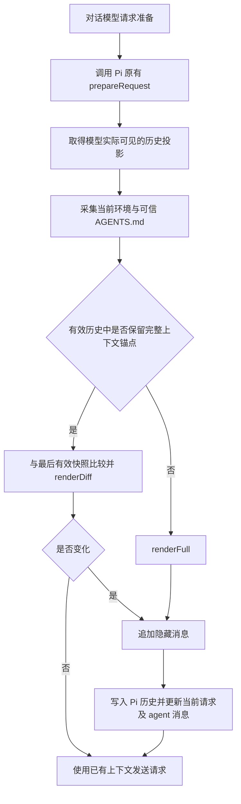

# ArkCode 静态与动态上下文机制

本文记录当前实现，更新于 2026-11-03。ArkCode 使用稳定的 system 行为准则、按会话策略声明的工具和追加式动态上下文构造对话请求。动态信息更新时保留已有消息，便于模型供应商复用相同的请求前缀。compact 由 ArkCode 重建检查点并替换模型可见历史。

## 请求由哪些部分组成

| 部分 | 内容 | 提供方式 | 更新时机 |
| --- | --- | --- | --- |
| 静态行为准则 | ArkCode 身份、个性、自主推进、写作、编码、用户协作、工具使用和回复格式 | `SYSTEM_PROMPT`，由 Pi 构建 system prompt | 创建或替换 AgentSession 时使用当前代码中的版本 |
| Pi 工作目录段 | 当前会话的 cwd | SDK 添加的 system prompt `cwd` 段 | 创建或替换会话时确定 |
| 工具模式指南 | 内置工具当前模式和 MCP 启用的暴露方式 | `builtin_tool_mode` 与 `mcp_tool_modes` system 段 | 首次请求前及成功 compact 后应用最新配置；其余请求沿用有效策略 |
| Shell 指南 | 当前 bash 工具的解释器、命令语法和路径写法 | `shell_environment` system 段，从执行器实时读取 | 每次请求准备时读取，包括同一 run 的工具后续请求 |
| 工具声明 | 基础工具、CodeMode／搜索入口与 MCP 的名称、描述及参数 schema | 由 Pi 按实际协议序列化 | 模式在新会话／成功 compact 更新；MCP 发现与目录变化按运行时处理；权限切换不改变声明 |
| 对话历史 | 用户输入、模型回答、工具调用及结果、compact 摘要 | Pi 会话历史的有效投影 | 随对话追加，compact 可改变模型可见的历史 |
| 动态上下文 | 环境信息、全局 AGENTS.md 及可信项目 AGENTS.md | 内部隐藏 custom 消息，发送前转换为 user role | 每次对话模型请求准备时检查，仅有变化时追加 |
| Shell 会话 | 当前 run 的有效句柄、状态、已披露文件和未交付的结束通知 | `arkcode-shell-sessions` 隐藏 custom 消息 | 请求准备时检查；compact 替换历史后重新补入，不消费输出，不唤醒空闲模型 |
| Skills 目录 | 已启用且允许自动选择的 Skill 名称、描述与路径 | Pi system prompt 的 skills 段 | 每个 agent run 开始时按当前启停配置重建 |
| 明确选择的 Skill | `/skill:name` 或 `@skill:name` 对应正文 | 激活说明与 `<skill-loaded>` 块，随用户消息持久化 | 提交或入队时读取快照 |

“静态”指行为文本不随日期、权限模式和 AGENTS.md 改写。当前 SDK 仍会添加 cwd 段，因此不同工作区的完整 system prompt 可以不同。

Skills 只发现用户及可信项目 `.agents/skills`，默认不将正文加入上下文。宿主复用 Pi 的解析、目录格式与消息接口，使用 read 按需读取，或在用户明确选择时加载正文。启停后的目录变化会改写下一个 run 的 skills 段，因此该变化可能影响 system prompt 缓存；它没有复用 AGENTS.md 的追加式差量机制。历史正文不会因禁用而删除，当前目录明确取代此前目录。发现层级、读取限制与会话行为见 [Skills 机制](SKILLS.md)。

ArkCode 不加载项目 prompt templates、主题或扩展。Skills、工具装配和 MCP 等内置扩展由宿主显式注册。原生 compact 文件跟踪扩展已移除，历史中的文件操作证据由摘要交接。

初始工具策略以 `arkcode-tool-settings` custom entry 保存，后续 compact 将策略写入同一份 ArkCode 检查点，不参与模型上下文。resume／fork 读取当前分支检查点。基础工具模式和 MCP exposure 在 compact 提交时一起更新，提交前失败或取消恢复旧策略；提交后激活异常阻止请求直到恢复。`arkcode-tool-catalog` 保存可用工具名称，发生停用时追加隐藏的 user-role 通知；执行资格仍由 SDK 路由及宿主执行前检查强制控制。

新增工具声明复用 Pi 的兼容能力：支持时使用追加声明，否则发送当前顶层工具列表。Pi 当前 Responses／Chat Completions 增量路径遇到移除或同名重定义会回退完整列表；具备相应能力的 Anthropic 模型有原生变更块。当前内置 DeepSeek Flash 使用 Chat Completions，未开启工具增量能力。不能由协议名称推断缓存稳定性，compact 也可能改变可复用的前缀。

## 静态 system prompt

`src/context/prompt.ts` 中的 `SYSTEM_PROMPT` 依据中文草稿翻译为英文，分为身份说明和七个部分。

- Personality：保持友善、好奇和独立判断。
- Autonomy and persistence：推断任务范围，自主推进，完成未受阻的工作，交付前核对明确要求。
- Writing：匹配用户语言，使用平实、连贯的文字，按内容选择结构。
- Coding：遵循周围代码，限制无意义注释和测试，运行相称检查，并按复杂度撰写 PR 描述。
- Working with the user：区分进度与最终交付，解释必要确认，接收中途调整，压缩后持续工作。
- Tool use：专用文件工具优先，独立调用并行，依赖和冲突写入串行；用户拒绝调用后调整方案。
- Response formatting：Markdown、本地文件链接和列表空行等输出约定。

静态正文保留面向未来 Web/桌面端的进度消息折叠约定，并不表示当前终端已经实现折叠。七个基础工具为 `read`、`write`、`edit`、`grep`、`glob`、`bash`、`shell_control`。脚本环境说明、参数 schema 和生成的工具目录继续位于 SDK 的工具描述中。

`createResources()` 提供这段文本，其 `getAgentsFiles()` 始终返回空集合，避免 AGENTS.md 同时进入 system prompt。动态机制通过独立的 `InstructionsLoader` 读取全局与可信项目指令。

## 工具模式 system 段

`src/context/tool-modes.ts` 保存六段英文指南，由 `createToolLoadout()` 在 `before_agent_start` 注册为具名 section provider。

| system 段 | 选择方式 | 指南内容 |
| --- | --- | --- |
| `builtin_tool_mode` | 按 `SessionToolSettings.current.toolMode` 选择一段 | `direct` 直接调用；`codemode` 可直接或通过脚本调用，批量和结果过滤优先脚本；`codemode-only` 只通过脚本调用内置工具 |
| `mcp_tool_modes` | 按 MCP controller 当前启用服务器的有效 exposure 和单工具覆盖，依次组合 `direct`、`codemode`、`deferred` | 直接调用、脚本内发现与调用、按需搜索后加载声明；没有公开模式时省略整个段 |

两个段位于 SDK 默认段之后，依次为内置工具指南、MCP 指南。MCP 的 `hidden` 不生成使用指南，停用服务器也不贡献模式。这里列举启用配置所使用的访问方式，不复制服务器、工具目录或连接状态；具体可调用的工具以当前声明和发现结果为准。指南使用 controller 的 SDK 配置，避免 `/mcp exposure` 修改磁盘与管理界面后提前使用待应用的 exposure。

Pi 1.2.0 的宿主补丁增加 `BuildSystemPromptOptions.sectionProviders`。provider 在每次 system 构建时求值，输出与静态 `sections` 一起交给 SDK 原有 section diff 与历史持久化。首次 run、工具继续及同一 run 自动 compact 后均使用当前有效策略；文本不变时不追加重复模式更新。不改写既有 system 前缀，也不访问 SDK 私有字段。

`/tool-mode` 和 MCP exposure 先保存默认配置。新会话尚未请求 LLM 时可反复选择，首次 `before_agent_start` 统一读取最新配置并应用到工具注册、MCP exposure 和模式指南。向 provider 发起首次请求前，宿主持久记录 `arkcode-tool-request-state`，此后每个新 run 沿用分支当前策略，直到成功 compact 才一起应用待切换模式。请求被中断或失败也保留已请求状态；恢复和 fork 继承分支中的状态，不能通过中断首轮或重启提前切换。有历史但缺少请求状态的旧会话按已请求处理。此状态和工具策略快照都不进入模型上下文。

compact 失败不应用已请求会话的待切换模式。未请求的新会话即使空 compact 失败，仍可在首次请求时应用选择。MCP 停用仍立即阻止调用，启用和目录变化沿用现有运行时机制。Skills 仍在每个新 run 开始时刷新目录文本；自动目录为空时省略 skills 段，不添加空目录占位提示。此前有目录而现在变空时，通过 SDK section 删除更新清除旧段。明确选择的 Skill 正文仍随用户消息加载。

## 动态环境字段

`src/context/dynamic.ts` 使用 `ContextSnapshot` 保存环境和项目指令快照。

| 字段 | 含义 | 采集方式 |
| --- | --- | --- |
| `cwd` | 会话工作目录 | 创建会话时传入，切换工作区时重新安装机制 |
| `platform` | Node 平台标识，例如 `win32` | `process.platform` |
| `os` | OS 类型与版本 | 安装机制时读取 `os.type()` 和 `os.release()` |
| `shell` | bash 工具实际使用的 shell | 每次请求准备时通过回调读取当前 `ManagedShell.executable`；Windows 自动发现 Git Bash，找不到时回退 PowerShell |
| `current_date` | 当前时区中的日期 | 每次请求准备时读取时钟，格式为 `YYYY-MM-DD` |
| `timezone` | 宿主时区 | 每次请求准备时读取 Intl 的时区，缺省回退为 UTC |
| `git_branch` | 当前 Git 分支或无仓库状态 | 每次请求准备时调用 `getBranch()` |
| `execution` | 宿主执行可用性 | `available` 或 `inspection-only` |

`shell_environment` 系统提示词段使用同一个 `ManagedShell` 的配置，提供解释器类型、对应的 Bash/POSIX 或 PowerShell 语法，以及 Windows 路径写法。具体可执行文件路径集中放在动态环境的 `shell` 字段，不在系统提示词、bash 工具描述或 CodeMode 工具目录中重复。工具定义也依据该配置选择 Pi 的 Bash 或 PowerShell 工具，不再仅依据 OS。该段在 direct、codemode 和 codemode-only 中都存在；恢复或压缩后的请求重新使用当前配置，旧会话中的 shell 信息不决定当前命令语法。

`ManagedShell` 在创建时冻结 shell 配置，常规运行不提供切换入口，执行失败也不会自动回退到另一个解释器。提示词与动态环境仍通过回调读取同一个执行器，避免保留启动时的快照。工具装配在 `before_agent_start` 和 `turn_end` 检查 shell 是否变化；若发生意外变化，重新注册工具描述并清除旧审批缓存。下一个模型请求即使用新 shell 的指南、环境及工具定义，包括无需新用户输入的工具继续请求。已发送或正在生成的模型请求无法追溯修改。

`execution` 来自执行未确认、历史存储失败和 viewer 状态，表示宿主恢复或执行限制。它不表示 Always Ask、Ask When Needed 或 Never Ask，也不提供完整工具权限矩阵。真正的限制由执行入口强制检查；viewer 和存储失败通常会在发送模型请求前被阻止。

宿主不会注入每轮时间戳、已用 token、UI 的 Working 状态或权限模式。这样可避免没有必要的差量消息。

## AGENTS.md 的读取与替换

每个会话持有一个 `InstructionsLoader`，在每次对话请求准备时重新发现和读取。只识别 `AGENTS.md`，不读取 `AGENTS.override.md` 或备用文件名。workspace 使用会话 cwd，bash 中临时 `cd` 不会改变它。

加载顺序如下：

1. 全局配置目录的 `AGENTS.md`，默认 `~/.arkcode/AGENTS.md`，遵循 `--home` 和 `ARKCODE_HOME`。全量读取、去除首尾空白，即使 workspace 未信任也加载。
2. 对可信 workspace，从 cwd 向上寻找最近包含 `.git` 的目录。`.git` 可以是目录或 Git worktree 使用的文件。找到后，按 Git 根到 cwd 顺序读取各级 AGENTS.md；不越过 Git 根。找不到时仅从 cwd 开始，项目外父目录不会加载。父目录 Git 标记检查失败不阻止 workspace 自身规则加载。
3. 深度优先递归 workspace 的子目录，每级目录名使用稳定的字典序。先父目录、后子目录；不扫描 workspace 外 Git 祖先的其他分支。

项目文件共享 `settings.json` 的 `projectDocMaxBytes`，默认 32768 字节，可设为 0 禁用项目指令。没有单文件独立额度；全局文件和 XML 包装不消耗该预算。超限文件保留剩余预算允许的字节前缀，发出一次宿主提示，后续文件停止加载。按字节截断可能切到 UTF-8 字符中间，此时使用替换字符。空白文件不进入指令集合，也不消耗预算；非普通文件跳过。读取项目文件时最多读取剩余预算加一个探测字节，不将整个大文件读入内存。

每份项目规则在动态消息中标注所在目录的 `scope`，只作用于该目录和后代。冲突时更具体的规则优先，同级目录规则互不影响。全局规则使用 `kind="global"` 和 `scope="all workspaces"`，作为所有项目的默认规则。

递归不进入 `.git` 元数据目录。文件符号链接允许读取；目录链接仅在真实目标位于 workspace 内时跟随，并按真实目录路径去重，避免循环或加载工作区外的目录树。递归规则的 scope 使用真实目录路径，因此先遇到目录别名也不会让实际目标目录失去规则。不存在的文件或扫描期间消失的目录跳过。其他项目发现或读取错误会省略此次整个项目指令集合并提示，不发送部分集合或继续使用旧项目规则。全局读取失败会保留当前加载器最后一次成功值并提示；确认删除、变为空白或非文件时清除全局规则。持续相同的问题只提示一次，恢复后再次出现会重新提示。

全局优先、项目共享预算、空文件和信任处理参照本地 Codex 实现。workspace 子树递归、限制目录链接不逃出 workspace、使用有界文件读取是 ArkCode 的扩展；Codex 自身的自动发现只覆盖 Git 根到 cwd 的祖先路径。即使递归发现，预算耗尽或读取失败仍可能让更深的指令无法自动注入，模型处理对应目录时需检查适用的指令文件。

AGENTS.md 的路径、内容、作用范围或集合变化时，宿主追加整个当前集合，并声明它替换此前宿主提供的项目及全局指令。首次没有任何全局或可信项目指令时，省略整个 `project_instructions` 块；只有全局指令时仍加载全局内容。已加载的指令被全部删除时，追加一次简短失效通知，后续无变化不再追加。旧消息仍在历史中，模型依据替换声明使用当前版本。压缩前仍有旧指令历史时，新的完整锚点保留失效通知，避免摘要中的旧规则继续生效；旧版本上下文无法解析时也保守地发送失效通知。

指令内容与环境值均进行 XML 文本转义，避免原文中的标签破坏宿主生成的外层结构。

`InstructionsLoader` 分别缓存目录发现结果和按字节读取的文件内容。后续请求仅检查目录、Git 标记及指令文件的元数据；发现结果未变时不再枚举目录，文件身份、大小、修改时间、状态变更时间和权限未变时复用正文。目录元数据覆盖没有指令的目录，因此新建、删除和移动指令文件或目录会使发现结果失效。指令预算耗尽后缓存的发现结果标记为未完成，正文变短释放预算后继续发现更深的规则。

普通请求复用缓存；compact 调用的 `capture()` 会先清空缓存再采集完整基线。安装接口也提供 `invalidate()`，供显式刷新使用。缓存由当前会话加载器持有，不共享到其他会话，不依赖文件监视器或后台线程。日期、分支等轻量环境检查和“有变化才追加”的规则保持原样。

## renderFull 与 renderDiff

`renderFull(snapshot)` 生成完整的 `<environment_context>`，有指令内容或需要清除旧规则时才附加 `<project_instructions>`。`renderDiff(previous, current)` 只输出变化的环境字段；项目指令发生变化时输出完整指令替换集合，集合变空时输出简短失效通知。所有值相同则返回 `undefined`，不追加消息。

第一次请求的动态内容形如：

```xml
<environment_context>
<cwd>D:\ArkCode</cwd>
<platform>win32</platform>
<os>Windows_NT 10.0.26200</os>
<shell>powershell.exe</shell>
<current_date>2026-10-13</current_date>
<timezone>Asia/Shanghai</timezone>
<git_branch>main</git_branch>
<execution>available</execution>
</environment_context>
<project_instructions>
These replace all previously supplied project instructions, including global instructions. Earlier sources omitted below no longer apply. Global instructions apply to all workspaces. Each project file applies only to its scope directory and descendants. More specific directory instructions take precedence on conflicts within their scope; sibling directory rules do not apply to each other.
<instructions kind="project" path="D:\ArkCode\AGENTS.md" scope="D:\ArkCode">
项目指令内容
</instructions>
</project_instructions>
```

日期跨日且其他值未变时，只追加：

```xml
<environment_context>
<current_date>2026-10-14</current_date>
</environment_context>
```

新日期本身就是提醒，不另外增加普通用户可见消息。

## 请求准备与隐藏消息

`installDynamicContext()` 包装 Pi 的公开 `session.agent.prepareRequest`。这个入口覆盖首次对话请求、工具调用后的继续请求，以及 compact 后下一次对话请求。“按 turn 更新”在当前实现中具体指每次对话模型请求边界，粒度比用户按 Enter 提交一次任务更细。



宿主在待处理用户输入和工具结果已加入上下文后，追加动态消息。它不插入旧历史中间，也不改写已有消息。单纯的 HTTP 传输重试不是额外的环境刷新定时器，独立的 compact 摘要请求也不经过这段对话注入逻辑。

内部消息使用以下结构：

```text
role: custom
customType: arkcode-context
display: false
content: 本次完整或差量文本
details: { version: 2, kind: full | diff, snapshot: 完整当前快照 }
```

Pi 的消息转换器将该 custom 消息转换为供应商请求中的 `user` role，只发送 `content`。`details` 中的完整快照用于宿主恢复基线，不作为额外 prompt 发送给模型。XML 标签只是文本结构，不会将消息提升为 system 权限。

宿主直接追加持久消息并更新当前请求，不发出动态消息的 UI 生命周期事件。TUI 历史恢复也会跳过 `display: false` 的条目，因此动态上下文不会成为可见转录。隐藏只指 UI 展示；内容仍发送给模型并保存在会话文件中。

追加前后有请求取消检查。新消息使用持久条目的时间戳，使当前请求中的消息与后续恢复出的消息保持一致。

## 会话生命周期与刷新规则

| 情况 | 行为 |
| --- | --- |
| 新会话首次请求 | 没有有效基线，注入完整上下文 |
| 后续用户轮次 | 重新采集；不变则不追加，变化则追加差量 |
| 工具续跑 | 在下一次对话请求前重新采集，工具造成的分支或 AGENTS.md 变化可在此时进入上下文 |
| 跨日 | 按宿主时区计算新日期，下一次对话请求追加日期差量；空闲时不主动唤醒会话 |
| 恢复会话 | 重新采集当前信息，对比有效历史中的基线；相同则不重复注入 |
| fork | 使用分支保留的有效消息确定基线，首次请求重新采集当前信息；不重放工具 |
| 切换工作区 | 创建对应 AgentSession，使用新的 cwd、shell、信任状态和当前信息 |
| 手动或自动 compact | 检查点直接重建完整上下文锚点，下一次请求只对比并追加真正变化的差量 |
| 权限模式切换 | 只更新执行时的审批策略，不添加权限 prompt，不改变基础工具声明 |

`contextUpdate()` 只相信模型当前有效历史中的 `arkcode-context` 消息及通过 schema 验证的元数据。它从完整 `full` 消息建立基线，然后接受其后的 `diff` 快照；如果只剩差量而没有完整锚点，必须重新注入完整内容。

版本 2 的指令快照包含全局/项目类别和项目目录作用范围。旧版本 1 不作为差量基线，恢复旧会话后首次请求会注入完整的当前上下文。

因此，compact 后即使宿主知道先前快照，也不会假定模型仍拥有完整环境和项目指令。完整锚点被压缩掉时补回 full；锚点仍保留且值未变时不重复追加。compact 摘要中的旧环境信息不会建立基线。失败的 compact 不会仅因尝试过压缩而清空基线。

ArkCode 的 `src/compaction/` 负责压缩。最近最多 20k 估算 token 的真实用户文本与当前完整上下文分别保存，摘要使用 Codex 原版交接前缀，不保留近期原始 assistant/tool 尾部。历史 Skill 正文不恢复为独立上下文；原始 Skill 选择文本和当前目录保留，模型需要时通过 read 读取。尚未交付的新输入沿用正常的 Skill 展开。原始 JSONL 保留完整消息，但首版不向 agent 提供历史检索功能。完整规范见源码仓库的 [压缩设计](../implementation/COMPACTION_DESIGN.md)。

## 权限与 prompt cache

七个工具始终注册。Always Ask、Ask When Needed、Never Ask 的差别由 `ApprovalBroker` 与宿主执行入口处理，模型使用相同工具声明。静态 prompt 要求模型直接提交所需调用，宿主决定自动批准、询问或拒绝，模型不得绕过拒绝。shell_control 的 wait/stop 仅操作当前 run 所属会话；send 的输入审批独立于启动审批。

缓存设计的目标是保留供应商可以复用的相同前缀：

1. 日期、分支和 AGENTS.md 不改变静态行为文本。
2. 动态变化追加到历史末尾，已有消息保持原样。
3. 环境未变时不重复添加消息。
4. 权限切换不改变工具 schema，也不产生权限模式提醒。

compact 会重组有效历史，因此完整对话前缀不再保持。新工作区、代码版本导致的 system prompt 更新、模型或供应商切换也可能影响缓存。当前测试验证请求内容和前缀一致性，没有测量真实模型供应商的缓存命中率。

## 代码入口与验证范围

| 文件 | 职责 |
| --- | --- |
| `src/context/prompt.ts` | 静态行为文本 |
| `src/config/settings.ts` | 配置校验、项目指令预算与静态资源加载 |
| `src/context/instructions.ts` | 全局、Git 祖先及 workspace 递归规则发现、字节预算、错误恢复 |
| `src/context/dynamic.ts` | 快照 schema、完整/差量渲染、隐藏持久消息、请求注入和检查点完整基线采集 |
| `src/compaction/` | 用户原文来源、摘要、预算、裁剪、检查点提交和恢复 |
| `src/app/host.ts` | 会话安装、隐藏历史过滤、执行恢复限制 |
| `src/tools/index.ts`、`src/permissions/approval.ts` | 基础工具声明及执行时审批 |
| `src/tools/shell-contract.ts`、`src/tools/shell-context.ts` | Shell 使用指南、会话清单及不消费输出的结束通知 |
| `test/context.test.ts` | 跨日、差量、完整锚点丢失与取消行为 |
| `test/instructions.test.ts` | 规则顺序、递归作用域、大小、信任、链接、读取失败、配置和删除刷新 |
| `test/runtime.test.ts` | 本地模型请求中的 user role、前缀一致性、隐藏历史、AGENTS.md 修改/删除、恢复/fork/新会话、手动/自动 compact |

相关实现已通过类型检查、构建和本地测试服务驱动的请求验证。测试未调用外部模型，也不证明模型一定遵守项目指令替换声明；宿主权限和工具限制仍由代码执行。
